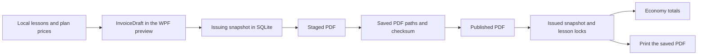

## Classes

### Student
    short name
    full name
    address
    phone
    email
    age bracket: young / standard
    birthdate (mandatory for age bracket 'young', otherwise optional)
    student plan (list: Plan with start/end dates for when the Plan is in effect for the student)
    schedule (weekday/time list)
    active: yes / no

### Plan
    name
    price (without VAT)
    lessons per week: 1 / 2 / by appointment
    duration in minutes
    flexibility: none / move or cancel by agreement
    number of students: 1 / 2
    effective date: <date/time>
    payment terms: paid monthly in advance / paid per lesson

### Lesson
    date/time
    student
    plan identity
    plan name
    Google Calendar event id, when linked
    invoice number, when invoiced

### Company
    name
    address
    phone
    email
    CVR: number / blank
    VAT register date: date/time / blank
    VAT status: not registered / registered
    invoice folder path
    bank registration number, bank account number, MobilePay account, and invoice payment instructions selected from fixed terms or custom text

### Invoice
    invoice number (unique, sequential; displayed with at least three digits, e.g. 001)
    date
    period: the month/date range the invoice is being written for
    company info
    student info
    (list) lesson date/time + lesson plan identity + issued lesson plan name + lesson price (without VAT)
    grouped service lines by lesson plan and price
    bank registration/account number lines, MobilePay account line, and payment instructions
  
  AND (optional, left out if not specified)
    price adjustment
    price adjustment reason (mandatory if price was adjusted)

  AND (ONLY if the company is VAT registered AND the invoice period starts on or after the VAT register date):
    total price without VAT
    VAT percentage
    VAT amount
 
  AND:
    total price

### Google Calendar Entry
  student short name
  date and optional time
  lesson state marker, when completed
  
## Business Logic

The student schedule is the agreed weekday(s) and time(s) that the student will have their Lesson. This is an indication and individual Lessons may be cancelled or moved. Likewise, the student schedule may be edited for permanent alteration.

Lessons are stored locally before invoice issue. Google Calendar remains the operational schedule source for uninvoiced lessons, but local `Lessons` records are the durable ledger records used for billing and invoice locking.

The Plan is an agreement between teacher and student and determines how many lessons there are per week and how much the student will pay for them. If the 'lessons per week' is 'by appointment', there is no fixed number.

Plan catalog entries have a lifecycle:
  * Draft: editable and deletable, but not assignable to students. A Draft may be incomplete.
  * Active: immutable and assignable to students; the only editable fields are the display name and `Retire on`, and the allowed catalog action is Retire.
  * Retired: immutable and not assignable to students; the display name may still be renamed, and the only lifecycle action is Reactivate.

A Draft Plan starts with blank name, blank price, one lesson per week, 60 minute duration, one student, move/cancel flexibility, `Paid monthly in advance`, the first day of the current month as effective date, and no `Retire on` date. All fields except `Retire on` must be filled with valid values before the Draft can be published.

Plans are managed independently from Students from the Plan menu. When an Active catalog Plan is assigned to a Student, the catalog Plan identity is stored on that Student's plan period and the commercial Plan fields are copied into that Student's plan period. After that assignment, catalog edits while Draft, publish/retire/reactivate actions, name-only renames, and future catalog cleanup must not mutate existing Student plan period commercial terms or issued invoices. Name-only renames are tracked with old name, new name, and change date/time so invoice-time names can still be understood later.

An Active Plan's `Retire on` date is equivalent to choosing Retire on that date. When the application starts, due Active Plans are moved to Retired so they no longer appear for new student assignment. Existing Student plan periods keep their copied Plan data until the Student is explicitly moved to another Active Plan.

When adding another Plan from Manage Plans, changed Draft fields are saved before the new Draft is created. If the selected Active Plan has an unsaved `Retire on` change, the user is asked whether to save or discard that change before adding the new Draft. When closing Manage Plans with unsaved editable changes, the user is asked whether to save, discard, or cancel the close.

Students may be moved to a different Active Plan by creating a new assigned student plan period.

If a new Plan is added to a Student, it takes effect at the Plan effective date/time.
If the new Plan effective date/time is in the future, the new Plan is not in effect until then.
Student plans may have an individual start date, in which case the will not take effect until then.
The old Plan is in effect until the new Plan takes effect.
There can only be one active Plan for a Student.
Old plans are retained for the Student, with information on when they started and ended.

If a Student leaves, the current Student Plan is listed with that effective end date and the Student is marked active:no.

When a Student starts, the Student Plan start date marks the first lesson.

The application will sync with Google Calendar.

Google Calendar is the repository of truth for scheduling details of uninvoiced lessons.
Once a lesson is invoiced, the local lesson record is locked to that invoice and later Google Calendar edits or deletions are ignored for billing and audit purposes.
Issued invoice lines remain immutable invoice-time snapshots for the printed invoice content.

Google authorization requests the `https://www.googleapis.com/auth/calendar.events.owned` OAuth scope. This lets the app read, create, move, complete, and delete events on Google calendars owned by the signed-in account, including lesson appointments the user creates manually in Google Calendar. The configured calendar should therefore be owned by that account; the app does not request broader all-calendar event access merely to inspect shared calendars. Stored OAuth token payloads must remain Windows user-protected and token file names must be collision-resistant for distinct token keys. Startup and automatic dashboard refresh must use only saved local credentials and must not launch browser OAuth; explicit connection or reconnection happens through `Application > Settings > Connect Google Calendar`. Legacy escaped token filenames are accepted for compatibility and migrated to hashed filenames on successful token lookup.

Relevant Google Calendar entries are identified by their first line, which may be one of these:
  $ <student short name>
  $<student short name>

Google Calendar entries that are *NOT* identified as relevant by their first line are *ALWAYS* ignored.

Calendar titles match trimmed Student short names without regard to case. New or renamed Students must have distinct short names under that same rule. The Ledger warns about duplicate labels in older databases and leaves ambiguous appointments unlinked. Each Student remains selectable by ID, and an existing calendar link retains its Student ID when the label changes. Calendar linkage combines the configured calendar identity and the external event ID. Refresh preserves local billing rows when events are outside the current calendar results. Use the Ledger's explicit delete action to remove an uninvoiced lesson. Legacy event IDs are adopted when the observed event, existing student marker and lesson time agree.

Dashboard refresh resolves observed events to local lessons before building the view. The reconciliation step saves eligible lesson updates for the selected student and supplies the saved records to the dashboard projection. The projection uses those records and issued invoice facts to build lesson rows and navigation choices.

The first line remains the ownership/matching marker. A completed uninvoiced lesson may additionally contain this later line in the Google Calendar entry:
  Status: Completed

If that later status line is absent, the lesson is treated as Planned.

When an Invoice is issued, it is added to the Invoice table with its issued invoice lines, and the included local Lessons are linked to that Invoice number. Each issued invoice line also stores the local Lesson ID for the lesson it invoices. Those lesson links are the durable local record of which lessons were invoiced.

Issued invoice lines are authoritative for invoice-to-lesson lineage. The lesson row may keep an invoice-number cache for locking and display, but that cache must be maintained by the invoice finalization transaction and must never replace the issued invoice line's exact local Lesson ID as the durable reference.

Invoice history uses the invoice's Student ID. Names and addresses on an invoice are snapshots of the original recipient. The upgrade links an existing invoice to a student when its saved lesson links all identify one student. Invoices with unknown ownership remain available through the Economy overview.

An upgrade archives older invoice lines that lack a valid unique lesson link in `ArchivedInvoiceLines` before rebuilding the active line table. The invoice header, its totals, the original PDF, and any valid lesson links are retained. The one-time startup warning reports the number of lines excluded from active lesson links. Upgrades that ran under earlier versions require an older backup to recover any lines already removed.

Invoice, completion, and payment state must only be applied to a lesson through that lesson's durable local identity and invoice link. The application must never infer that a lesson is invoiced, completed, or paid merely because it has the same student, date, time, or plan as an issued invoice line; a separate lesson on the same date remains separate and uninvoiced until it is explicitly included in an invoice.

Issued Invoice lines store the catalog Plan identity for lineage/reporting and also store the Plan name as it appeared when the Invoice was issued. Invoice viewing and PDF output use the stored issued-time Plan name snapshot, not current catalog names and not a derived lookup through Plan name-change history.

## Actions

### Application Startup

Before the main window is shown, the application creates the app-data folder if needed. When an existing SQLite database has pending migrations, startup first creates and verifies a database backup under `Backups` in the app data folder. A failed backup stops the upgrade. Startup then applies pending EF Core migrations. Startup then composes the local repositories, Google Calendar gateway, invoice PDF/printing services, and WPF view models through the App-layer bootstrapper. Schema changes must be represented as EF migrations, not ad hoc startup table/column mutation.

Upon startup the application displays a window containing the current student short name and a list of lessons for:
  * previous month
  * current month
  * next month

Each lesson in the list contains:
  - date/time
  - plan
  - state: completed / planned
  - invoiced: yes / no
  - paid: yes / outstanding (only if invoiced)

Lesson state does not change automatically merely because the lesson date/time has passed. The user marks a Planned lesson as Completed manually.

The main application window does not display student prices or monthly payment amounts. Prices belong in invoice preparation/printing and later administration views, not on the everyday lesson screen where students may see the display.

The application also opens Google Calendar in a separate browser window on the screen.
(if we technically can open Google Calendar as a separate pane in the application, that may be preferable)

The application will automatically refresh the lesson list from Google Calendar as suitable.

There are Previous / Next buttons for the selected student. These navigate a calendar-based occurrence list, not an alphabetical student-name list. Google Calendar lessons for active students in the loaded previous/current/next month window are ordered by lesson date/time and the same Student may therefore appear multiple times before other Students appear. The initial position prefers the displayed Student's calendar lesson closest to the current time on the current date, then their first occurrence in the displayed month. The target Google Calendar lesson is selected in the lesson list so the reason for the selected Student is visible. If the target lesson is in another month, the displayed month changes to that target lesson's month. If there are no Google Calendar lessons in the loaded navigation window, navigation falls back to active Students' saved standard schedule day/time entries for the displayed month; those fallback entries are schedule hints, not actual calendar lessons. The selected Student name also has a dropdown menu listing other active Student short names alphabetically. Choosing a Student from that dropdown directly switches the selected Student and refreshes that Student's rows, but does not select a lesson.
There are also Previous / Next buttons for the month, to switch the display back/forth by a month.

The application contains a Student menu with this entry:
  * Manage Students

Manage Students opens two coordinated windows: a Students list window and a fixed-size Student Details window. The main window also has a Student Details button that opens the same Student Details window for the currently displayed Student. The Students list includes all known Students, including inactive Students. Selecting a Student in the list updates the Student Details window, which shows Student fields, Active flag, current assigned Plan snapshot, plan assignment selector, schedule fields, and issued Invoices. Add Student creates a new draft in the details window. **Save** persists the edited Student data and closes Student Details after a successful save. **Cancel** discards the edits and closes Student Details. The window's title-bar close button still prompts when there are unsaved changes. Selecting an Active catalog Plan copies the Plan fields into the Student's plan period. Changing the Active flag, plan period dates, or schedule only persists when Save is pressed. Double-clicking an Invoice in the selected Student's invoice list opens it in the Invoice Viewer. Selecting a Student in Manage Students immediately refreshes the main window around that Student; closing Manage Students or a dashboard-opened Student Details window applies the final selected Student again. The Student Details window remembers position but uses fixed pane and invoice column widths.

The application contains a Plan menu with:
  * Manage Plans

Manage Plans lists Draft, Active, and Retired catalog Plans. Draft Plans can be edited, deleted, and published. Active Plans are read-only except for `Retire on`, and can be retired. Retired Plans are read-only and can be reactivated. Closing the window with unsaved editable changes prompts the user to save, discard, or cancel. Only Active Plans appear in the Student editor assignment selector.

The application contains an Economy menu with:
  * Overview

Economy Overview displays financial reporting for the selected invoice-period year. It defaults to the current calendar year and has previous/next year controls. It reads from the local SQLite issued invoice rows, stored issued totals, a stored first application-backed invoice month, and explicit manual month overrides; it does not read from stored PDF files. Only issued invoices are shown in the invoice list; in-progress `Issuing` reservations are hidden, and manual legacy month totals are not shown as invoices.

The first application-backed invoice month is a month-boundary cut-over point. The Settings control may use a date picker, but any selected day is normalized to the first day of that selected month. If no cut-over month is stored, all months are treated as application-backed and read-only. Months before the cut-over may use manual legacy values, but the cut-over does not hide real application-issued invoices before that date. If a pre-cut-over month has issued invoices and no manual override, those issued invoice totals remain visible and read-only. Months on or after the cut-over use application-issued invoice totals and cannot be manually edited. A month must not silently combine manual and application-backed totals; if persisted data contains both a manual override and application-issued invoices for the same month, the overview reports an actionable error instead of choosing one source or hiding data. When a blocking economy data error still has overview data available, the UI keeps the overview rows visible and disables export; in Admin Mode, manual Save/Cancel remain available so saving manual totals can remove invalid manual overrides from invoice-backed months.

Manual month values are DKK replacement totals for that month, not additive adjustments. The user enters net amount and VAT amount; total is derived as net plus VAT. Blank or zero manual net/VAT values remove the manual override. Manual month values do not create invoice rows, invoice numbers, invoice PDFs, local lesson rows, or Google Calendar events.

Manual editing is available only after Admin Mode has been checked and saved from `Application > Settings`. Admin Mode is session-only and starts unchecked each time the application starts. The durable first application-backed invoice month is configured in Settings and is shown only while Admin Mode is checked there. In Admin Mode, Economy Overview allows editing the net/VAT values for legacy months before the cut-over only when that displayed month is not backed by an application-issued invoice. Non-admin mode and application-backed months remain read-only. Saving manual totals persists only editable legacy manual rows and clears stale manual overrides for months that are backed by issued invoices.

Invoices and displayed month totals are grouped by the invoice period start date: Jan-Mar is Q1, Apr-Jun is Q2, Jul-Sep is Q3, and Oct-Dec is Q4. The window shows invoice number, PDF filename only, net amount, VAT amount, and total amount; month and quarter rows with no displayed total stay visible with blank amount cells. The Years table shows the selected invoice-period year and previous four years, with blank amounts for years without displayed totals. Double-clicking an invoice opens the stored PDF. The displayed data can be exported to one CSV file with `Section`, `Year`, `Label`, `InvoiceNumber`, `Filename`, `Net`, `VAT`, `Total`, and `Source` columns; amount fields use machine-friendly invariant decimals such as `1234.50`.

The **Student Invoices** pane shows the selected student's issued invoices. Clicking **Outstanding** marks an issued invoice **Paid**. Clicking **Paid** asks for confirmation before marking it **Outstanding**. Double-clicking an issued invoice opens its saved PDF.

The reservation that is blocking new invoices appears as **Pending** at the top of its student's list. Click **Pending** to open the recovery dialog. When another student is selected, a notice in the pane identifies the reservation and points to **Invoice > Resume Invoice**.

The application also contains a button:
  * Write Invoice

The lesson toolbar contains a `Populate Calendar` action for the selected Student and displayed month. This action seeds Google Calendar immediately from the selected Student's saved standard schedule:
  * The action checks the full displayed month from the first day through the last, including dates earlier than today. Each scheduled occurrence uses the Student's assigned Plan in effect on that date.
  * The action writes the resulting lesson entries to Google Calendar immediately and saves the created local billing lesson rows before reporting success; there is no separate save operation.
  * New timed events use the plan duration in effect on the occurrence date. Exact same-Student date/time matches in Google Calendar are skipped. An invoice-locked local lesson also occupies its original slot if its calendar event was moved or removed.
  * Version 1 does not detect or handle other calendar conflicts. Conflicts must be resolved manually by the user in Google Calendar.

Lessons that are completed or invoiced:yes CAN NOT be edited or deleted in the main lesson list.

The only allowed operation on a Completed lesson is to mark it back to Planned. This requires an explicit confirmation prompt. Once a Completed lesson has been marked back to Planned, and provided it is still invoiced:no, it can again be edited as a planned lesson.

The planned and invoiced:no entries in the lesson list may be edited directly in the main window:
  * date may be changed
  * time may be changed or cleared
  * plan may be changed
  * lesson may be cancelled (deleted)
  * new lesson may be added

`Add Lesson` starts a planned row dated today in the current month or on the first day of another displayed month. It uses the Student's first saved schedule slot for that weekday, or the first saved slot if the weekday has none. The Student's assigned Plan in effect on the draft date is selected if it can be assigned to new lessons. The button saves immediately when the date and plan are available. If the assigned plan is unavailable, selecting a plan in the draft saves it. If no Active plan exists, the application shows `Create or publish an active plan first.` Later edits to date, time, plan, or state are also saved immediately. Rapid changes to an editable lesson's plan must preserve and save the final selected plan.

Lesson date editing uses a date selector. Lesson date and lesson plan are required for a new lesson to be saved. Timed events created by Add Lesson use the selected plan duration. A lesson without a known time is saved as an all-day Google Calendar event, displays without a time in the lesson list, and prints without a time on invoices. Lesson time editing provides a no-time option plus a time selector from 08:00 through 20:00 in 15-minute increments while still allowing typed time input. Lesson cancellation uses an explicit delete action with a confirmation prompt.

Before changing or cancelling a linked lesson, the Ledger places a local hold on the lesson so it cannot be invoiced concurrently. Acknowledged Google Calendar writes update the local lesson before the next dashboard refresh. A rejected change releases the hold. If Google Calendar's result is uncertain or the local write cannot be completed, the lesson shows **Review needed** and stays out of billing. Use that action to reconcile the original event or confirm its removal after checking the configured Google calendar.

When adding a new lesson, Google Calendar event creation and local lesson persistence must preserve the exact selected plan. The main window uses the created Google Calendar event id to select the saved lesson. If Google Calendar creates the event but the follow-up refresh fails, the local lesson must still be saved with the selected plan identity and created Google Calendar event id. If local persistence fails after the Google Calendar event was created, the application must attempt to remove that created Google Calendar event and report the local-save failure instead of leaving a calendar-only lesson that can later be reconstructed with the wrong default plan.

When populating lessons from a saved schedule, the Ledger saves the event ID and plan for each acknowledged creation before attempting the next appointment. If a later creation fails, earlier successes remain saved. Reopening Populate Calendar reads the current calendar and skips the earlier appointments it finds. Check the calendar before retrying an uncertain creation.

A calendar appointment linked to an unambiguous Student but lacking an applicable plan appears as **Plan needed** alongside the other lessons. The appointment stays out of billing until the user chooses an active plan for it.

### Write and Print an Invoice

Choose **Write Invoice** in the main window to open the editable preview for the selected Student and the displayed month. Select another Student in the main window to invoice them. The button requires a selected Student and is disabled while an invoice reservation is pending. Resolve the reservation through **Pending** in the invoice list or **Invoice > Resume Invoice**.

The preview lists eligible local lessons for the selected Student and month, including when an earlier invoice exists for the same month. A pending reservation holds its exact saved lesson IDs out of any new draft. If the dashboard resolves an already issued invoice for the current view, the button opens that invoice in the viewer. Issued invoices are also accessible under **Student Invoices**.

The Invoice will contain the Company information.
The Invoice will contain the Student information.
The Invoice will contain the period/month it is written for.
The Invoice will contain grouped service lines summarizing lessons by issued lesson plan and price.
The Invoice will contain a single clear list of local uninvoiced lessons selected for that Student.
The invoice notes list each change between consecutive plan IDs, in lesson order. Each note uses the saved plan names and the date of the first lesson under the new plan.
The Invoice will contain VAT information, if currently relevant.
VAT applicability is based on the invoice period start date, not the invoice issue/print date.
The Invoice will contain price information.
The Invoice will contain the configured bank registration/account number lines, MobilePay account line, and payment instructions, if any.
The Invoice must fit on one PDF page. The included lesson list is indented in the middle lesson area, stays in one column through 10 lessons, and uses two columns above 10 lessons so payment instructions, totals, and footer text are not pushed to a second page.
Payment instructions are configured as one of:

- `Betales ved modtagelse`
- `8 dage fra fakturadato`
- `30 dage fra fakturadato`
- custom text

The payment instructions and totals should sit near the bottom of the invoice page, above the footer text.
The Invoice language is: Danish

The user may edit the list of lessons.
The user may add a price adjustment and reason.
The Invoice VAT and price information will reflect user changes.

The user may Cancel the edit before pressing "Save & Print Invoice".
If the user Cancels before printing starts, the invoice is not saved and no data are updated in the system.

Once the invoice has been edited, the user may press the "Save & Print Invoice" button on the Invoice form.
The ledger allows one unresolved invoice reservation at a time. If an older database already contains several, resolve the oldest first. The **Invoice** menu appears while a reservation is pending. Open **Invoice > Resume Invoice** to recover it from any Student or month. A safely unpublished tail reservation can be discarded and its number reused. An earlier reservation from a legacy backlog is recorded as void when discarded, preserving the historical number. Historical gaps are reported during startup for review.

The **Save & Print Invoice** action runs these steps.

  - Reserves the invoice number and saves the invoice snapshot, including the adjustment and reason, in SQLite. PDF generation uses the saved amounts, lesson lines, and billing details.
  - When an already open preview retries the same lesson selection with different details, shows the saved invoice and the current preview total. **Resume saved invoice** uses the saved details. **Use current preview** updates the pending snapshot under the same number while PDF publication is still pending.
  - Stages and verifies the PDF. Before moving it, saves the staged path, final path, and checksum in SQLite. The final file name includes the number, invoice period, and student's invoice-time name, for example `Invoice 001 Juni 2026 - Mira Vale.pdf`.
  - If a staging, writing, or verification error happens before the publication checkpoint is saved, discards the staging file and releases the reservation. After saving the checkpoint, retains the reservation and verifies the staged or final PDF on retry. A different file at the final path is preserved and reported.
  - Finalizes the Invoice data in the Invoice table as issued.
  - Sends a print request to the configured invoice printer, if one is configured and available.
    -- note: a print failure does not undo the issued Invoice or delete the PDF; the Invoice remains issued and can be reprinted from the Invoice Viewer.
    -- note: while writing/printing is in progress, the Invoice form stays open and Cancel/window close do not hide the in-progress result; if the operation takes longer than expected, the user is asked whether to keep waiting.
  - Closes the Invoice form and returns to the main view only when the Invoice was issued and the print request was launched successfully.
  - Shows a print warning in the open Invoice form if the Invoice was issued and the print request failed. **Reprint** uses the saved PDF and issued number.
  - When an Invoice is issued and returning to the main view, the displayed data in the main view are updated with any changes.
  
Once an Invoice has been *successfully* saved, it can no longer be edited.
Issued Invoices show payment and print status in the main/student invoice lists. The Invoice Viewer shows the stored PDF path, print status, and last print error when present. Reprinting an issued Invoice uses the stored PDF and existing Invoice number; it must not create a new Invoice number or change the issued Invoice content.

The invoice printer is selected from Application Settings during setup. If no invoice printer has been selected when printing or reprinting is first attempted, the app opens the printer selection dialog directly, lets the user choose a printer, and remembers that printer before continuing. The selected printer is remembered for subsequent invoice printing and can later be changed or cleared from Application Settings. When the app records an Invoice as Printed, that means the configured printer existed and Windows accepted the print request launch; the app does not verify physical paper output or Windows spooler completion.

### Invoice data flow

The preview copies billing details and prices into an `InvoiceDraft`. Each line keeps its local lesson ID so the ledger can lock the exact lesson when issuing the invoice. Confirming the preview saves those values and the invoice number as an `Issuing` snapshot.

**Resume Invoice** starts at the saved snapshot. The publication checkpoint lets the file store recognize a PDF already moved to its final path. Recovery follows the saved paths and checksum even if the default invoice folder changes. Economy reads the issued totals from SQLite. A failed print request can be retried using the published PDF.

## Settings saves

One **Save** commits the company profile, calendar preferences, and Economy settings together in SQLite, including any removal of obsolete Economy overrides. If the transaction fails, the previous values remain in effect. Printer selection saves through the same preferences workflow. **Connect Google Calendar** and **Forget Google sign-in** use the separate authorization workflow.

## Limitations

### Version 1.4.3

  * VAT exemptions for individual students are outside the current scope.
  * No formal VAT return or bookkeeping-system VAT report; Economy Overview summarizes issued invoice net/VAT totals plus explicit manual legacy month overrides only.
  * No automated payment reminders or due-date workflow.
  * No support for credit notes/correction invoices.
  * No integration with MobilePay/Bank for payment registration.
  * No tax reserve estimate.
  * No scheduled backups of the database or invoice folder. The Ledger backs up the database before upgrading its schema.
  * No calendar conflict detection for `Populate Calendar` beyond exact duplicate same-student same-date/time skipping.
